# 小家伙的小家伙｜医学生零基础使用说明书

适用：Windows 本地个人使用｜更新：2026-10-17

[观看演示视频](media/小家伙的小家伙-操作演示.mp4) · [练习材料](examples/)

## 先读这一页：你不需要会编程

这是给生理学、病理学、细胞生物学和生物化学学生准备的学习工作台。你可以把它理解为：电脑上一个能整理课件、辅助准备报告、陪你练习的小工具。日常使用不需要输入程序代码。

> 本说明书对应当前仓库版本，编写日期为 2026 年 10 月 17 日。配图和视频来自真实网页操作；为避免使用真实密钥和产生模型费用，视频中的 AI 返回是固定模拟示例，不代表真实服务商的效果。Windows 安装步骤是文字指导，尚未在真实 Windows 电脑完成实机验证。

| 你会拿到什么 | 怎样打开 |
| --- | --- |
| 操作演示 MP4 | 双击 docs/media/小家伙的小家伙-操作演示.mp4，用电脑视频播放器观看。视频有中文提示、鼠标高亮和章节，没有配音。 |
| 本说明书 PDF | 双击“使用说明书.pdf”，通常可以用 Edge、浏览器或 PDF 阅读器打开。 |
| 可编辑 Word 版 | “使用说明书.docx”，可用 Word 或 WPS 打开，适合打印和添加自己的笔记。 |
| 练习材料 | docs/examples 文件夹。它们是软件练习资料，不代替正式课件、实验方案或标准图谱。 |

如果你只想先试一次：按第 1～4 节装好并连接 API → 上传一份课件 → 生成知识清单 → 问一个问题。不要一开始把整学期所有材料都上传。

## 1. 使用前准备好这四样东西

| 准备项 | 具体要求 |
| --- | --- |
| 一台电脑 | 推荐 Windows 10 / 11，64 位（x64），安装 Edge 或 Chrome。可在“设置 → 系统 → 系统信息/关于 → 系统类型”查看。Mac、手机不适用下面的 Windows 双击安装流程。 |
| 项目压缩包 | 从项目 GitHub 仓库下载 ZIP，或使用维护者提供的“小家伙的小家伙-Windows.zip”。不需要在 GitHub 网页上逐个复制代码。 |
| 模型服务三项信息 | API 基础地址、模型名称、API 密钥。这些信息由你的模型服务商提供。前三个词不懂没关系，第 4 节有解释。 |
| 一份课程材料 | 例如一章 PPTX、可选择文字的 PDF 或 DOCX；没有正式课件也可以先用随包的练习材料。 |

第一次启动需要联网下载组件。以后打开界面、管理材料和指图练习主要在本机完成；使用远程模型生成内容时仍需要联网。AI 功能可能按服务商规则计费，工作台本身不会替你充值。

> ChatGPT 等聊天网站的会员，并不自动等于能在本软件使用的 API 余额或密钥。不要把网站登录密码填进 API 密钥框。

## 2. 下载、解压，再安装 Python

1. 打开项目仓库：https://github.com/GippertX-creator/Senbel4littleguy 。确认页面分支选择的是 main。
2. 点击绿色的 Code 按钮，再点击 Download ZIP。若拿到维护者给的部署包，可以跳过这一步。
3. 在电脑“下载”文件夹找到 ZIP，右键选择“全部解压缩/解压到”，选择你容易找到的位置，例如 D:\MedStudy 或“文档”下的学习工具文件夹。不要只在压缩包窗口里双击启动。
4. 打开解压后的文件夹。可能需要再打开一层 LittleBuddy 或 Senbel4littleguy-main。找到 start.bat、README.md、app 文件夹在同一层的位置。
5. 访问 Python 官方 Windows 下载页：https://www.python.org/downloads/windows/ 。选择 Python 3.12 的 64 位 Windows 安装程序（Windows installer 64-bit）。需要帮助时，把“请安装 Python 3.12 64 位，并添加到 PATH”这句话给维护者。
6. 运行 Python 安装程序。在传统安装界面勾选 Add python.exe to PATH，再点击 Install Now。出现安装成功提示后关闭安装程序。
7. 如果电脑已装 Python 3.11 或以上，可以先尝试下一节。若提示版本太旧，再安装推荐版本。

Python 是让这个学习工具能够运行的基础组件，不是你需要学习的编程课程。只需安装一次，之后每天使用不必重新安装。

> Windows 可能默认隐藏“.bat”等文件后缀。这时文件可能只显示为 start；可在资源管理器“查看 → 显示 → 文件扩展名”打开后缀显示，确认类型是 Windows 批处理文件。不要双击 app 文件夹中的程序文件。

## 3. 第一次打开：只需双击 start.bat

1. 进入刚才解压后的项目文件夹，双击 start.bat。
2. 出现一个黑色或深色窗口是正常现象。首次会下载并安装组件，窗口可能不断滚动英文内容；请等待，不要连续双击启动多个窗口。下载速度取决于网络。
3. 完成后浏览器会自动打开工作台。如果没有自动打开，保持启动窗口运行，在浏览器按 Ctrl+L，在顶部地址栏输入 http://127.0.0.1:8765 ，再按回车。不要把它输入到网页内的搜索框。
4. 看到“小家伙的小家伙”标题、左侧功能菜单和小猫，说明网页已打开。接下来配置 API，不要关闭启动窗口。

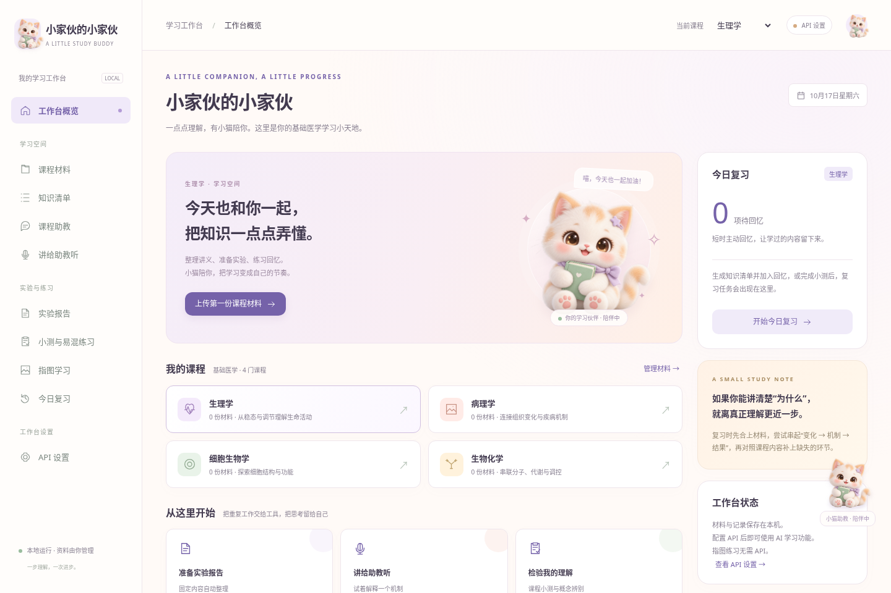

127.0.0.1 的意思是“这台电脑自己”。这是访问本机工具的地址，不是需要注册的网站，也不能发给同学让他们在另一台电脑直接访问。

| 你看见的现象 | 代表什么 |
| --- | --- |
| 黑色启动窗口一直开着 | 正常。它负责让网页背后的工具运行。最小化即可。 |
| 浏览器页面出现但显示 API 设置 | 正常。界面已运行，还没有输入本次使用的模型连接。 |
| 页面打不开或无法访问 | 先确认启动窗口没有关闭，地址是 http://127.0.0.1:8765。 |
| Python was not found / Please install Python | 没有找到合适的 Python，回到第 2 节安装并勾选 PATH。 |

以后的每日启动仍是双击同一个 start.bat。成功安装过的组件会复用，通常不需要重新下载全部依赖。

## 4. API 设置：三个框分别填什么

API 可以理解为“软件向模型提问的连接方式”。你需要向自己选用的模型服务商获取下面三项信息；不是从演示视频中照抄。

| 页面中的名称 | 通俗解释 | 你应填写什么 |
| --- | --- | --- |
| API 基础地址 | 通往模型服务的入口 | 服务商提供的 OpenAI 兼容基础地址。例如 https://api.openai.com/v1 只是一个格式例子，需确保你有该服务的访问权限和账户。不要加 /chat/completions。 |
| 模型名称 | 要使用哪一个模型 | 逐字复制服务商给出的模型标识，包括大小写和符号。不要填“随便”“ChatGPT”等不确定名称。 |
| API 密钥 | 允许软件使用你账户额度的凭据 | 从服务商控制台复制的 API Key。不是网站密码，也不是复制视频中的 DEMO 字符串。 |

1. 点击左侧“API 设置”。
2. 按服务商说明填写基础地址和模型名，再粘贴密钥。远程地址使用 https://。
3. 点击“测试连接”。这个按钮会先保存当前表单，然后发起一次很短的测试请求。
4. 看到“API 请求成功；可以开始学习”再继续。若出现错误，按第 15 节排查。

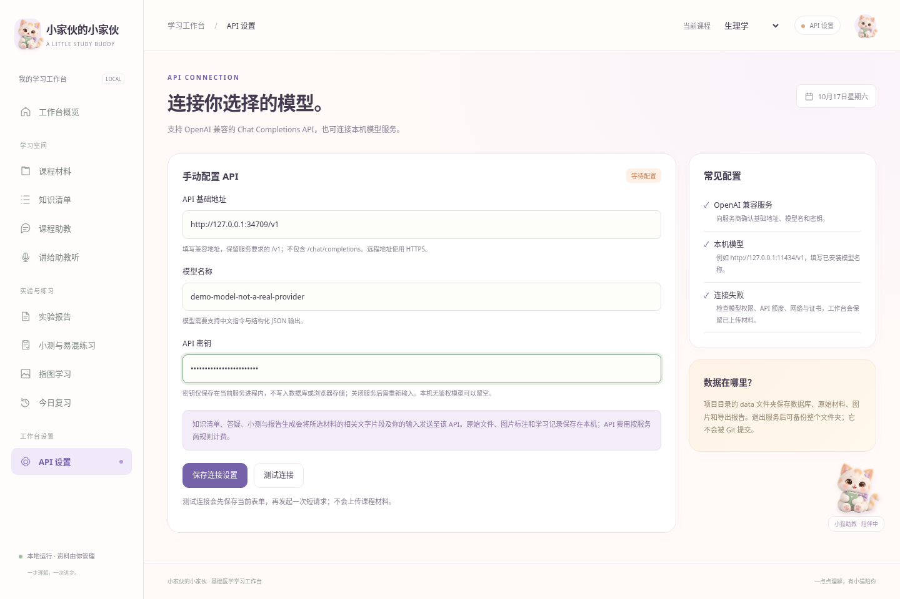

> 密钥仅保存在当前启动窗口对应的运行进程中。关闭服务或关机后，需要重新填写密钥；基础地址和模型名通常会保留。只刷新网页、且服务仍在运行时，一般不必重新输入。不要把真实密钥发给同学、贴在群里或出现在截图中。

右上角“API 已配置”表示本次运行已有密钥，不等于所有模型请求都一定成功。测试连接只验证一次基本请求，后续生成还可能受额度、网络、模型输出格式或材料长度影响。模型应支持 OpenAI 兼容 Chat Completions 与中文 JSON 输出。

没有 API 时，仍可上传和查看材料、建立图片标注、进行指图练习，并复习已有记录；生成新知识清单、AI 答疑、小测和报告则需要可用模型。

## 5. 上传材料：先选课程，再选用途

1. 在右上角“当前课程”选择生理学、病理学、细胞生物学或生物化学。不同课程的材料和记录分开管理。
2. 点击左侧“课程材料”。
3. 在“材料用途”选择课程材料、实验材料或报告模板。
4. 点击文件选择框，找到电脑里的文件；可以按住 Ctrl 选择多份同用途文件。
5. 点击“上传并解析”，等待下方列表出现文件名称。文件进入列表，才表示上传完成。
6. 点击文件右侧“查看原文”，检查文字是否提取完整。

| 用途 | 适合上传什么 | 后续用在哪里 |
| --- | --- | --- |
| 课程材料 | 教师 PPT、课程讲义、课后阅读 | 知识清单、课程助教、讲解反馈、小测。 |
| 实验材料 | 实验指导书、老师给的实验原理与操作内容 | 报告固定内容、实验原理学习、小测。 |
| 报告模板 | 学校要求的 Word 实验报告格式 | 报告结构和版式；模板本身不作为医学事实来源。 |

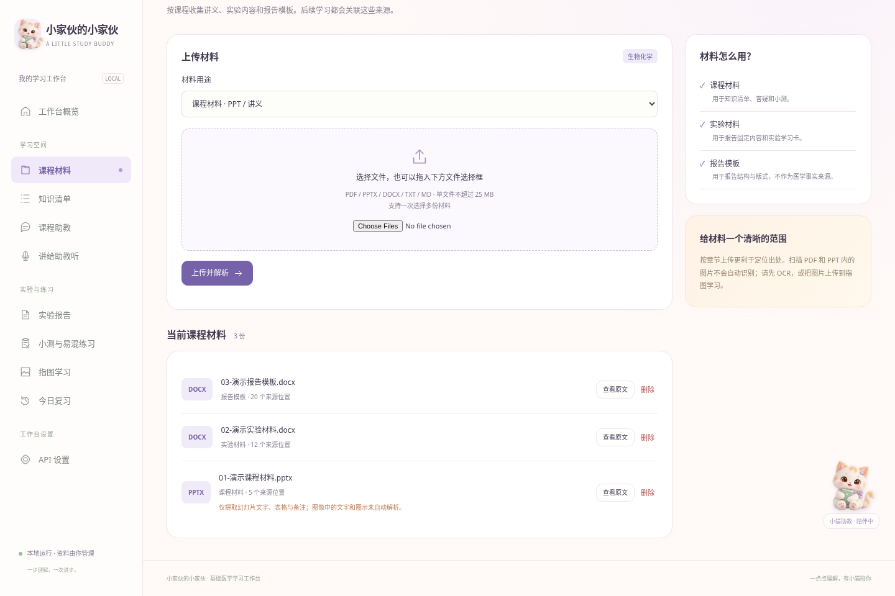

| 文件类型 | 注意事项 |
| --- | --- |
| PPTX | 支持幻灯片文字、表格和备注。旧版 PPT 请先在 PowerPoint 或 WPS 中“另存为 .pptx”。 |
| PDF | 可选择、复制文字的 PDF 更合适。扫描照片式 PDF 需先做 OCR（把图片文字识别成可复制的文字）。 |
| DOCX | 支持 Word 段落和表格。旧版 DOC 请另存为 DOCX。 |
| TXT / MD | 支持纯文字材料。不会保留原文件复杂版式。 |
| 文件大小 | 单个课程/实验/模板文件最大 25 MB；过大时按章节拆分。图片在“指图学习”上传。 |

PPT 或 PDF 中的图像、曲线和图片里的文字不会自动全部理解。仅有“上传成功”不代表每张图都读懂了。图像题可以使用指图学习，或补充图片的文字说明。

## 6. 知识清单：从一章课开始

1. 点击左侧“知识清单”。
2. 展开“学习依据”，勾选本次需要的课程或实验材料。报告模板不能单独提供知识来源。
3. 在学习范围中写一个小主题，例如“心肌兴奋性”“细胞损伤”“酶活性与控制变量”；也可以留空。
4. 点击“生成知识清单”，等待生成完成。处理时不要连续点击或切换课程。
5. 阅读知识点、机制联系和主动回忆问题。点击“加入主动回忆”，把这些问题放入今日复习。

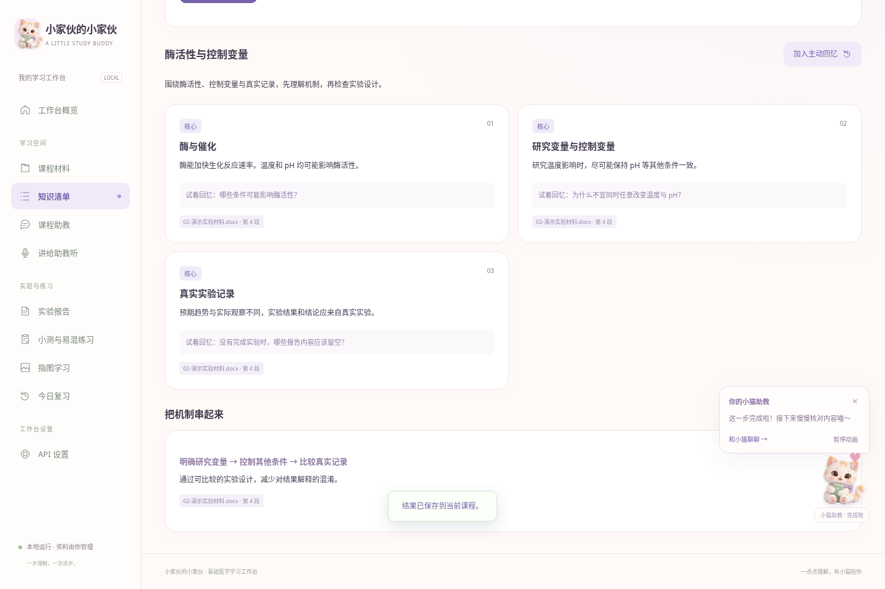

如果出现“只使用部分片段”的提示，说明材料太长，本次只选择了相关部分。缩小主题或减少勾选材料，再分批整理；不要把一次清单当作整学期内容的完整覆盖。

## 7. 看出处：点一下来源标签

1. 在知识点、解析或助教回答下方找到“文件名 · 页码/幻灯片/段落”等小标签。
2. 点击标签，弹出原文窗口。
3. 对照原文确认术语、定义和条件是否一致；PDF 是提取页码，PPT 是幻灯片序号，Word 通常是段落或表格编号。
4. 点击弹窗右上角 ×，返回学习页面。

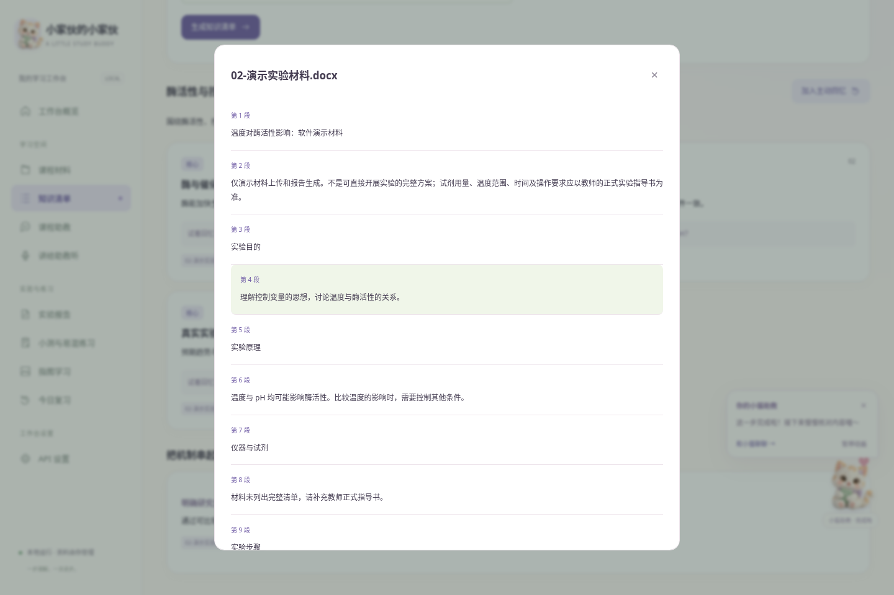

> 系统能检查引用的位置是否存在，但不能证明每一句医学结论都准确、有充分依据。对重要知识点、题目答案和报告内容，应再核对教师材料。小猫“完成啦”只表示请求完成，不表示医学结论已经审核通过。

## 8. 课程助教：像问同学一样提问

1. 点击“课程助教”，确认学习依据已经选择。
2. 输入一个明确问题，例如“为什么研究温度对酶活性的影响时，需要保持 pH 一致？”
3. 点击“向助教提问”。小猫会显示思考状态。
4. 看完解释后点来源核对，再继续追问“如果改为研究 pH 呢？”或“先给我一个提示，不要直接给答案”。

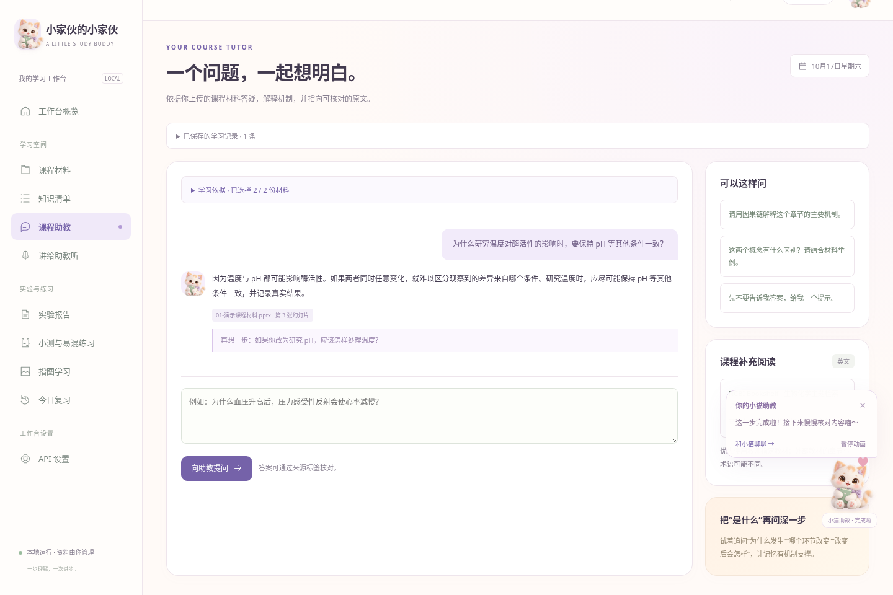

好用的提问方式：①“请用原因—过程—结果解释……”；②“我认为……，其中哪一步有问题？”；③“请只根据所选材料说明，不足时指出缺少什么。”问题越具体，越容易核对。

右侧英文开放教材入口是补充阅读，不等于教师指定教材。若术语或教学范围不同，以本课程要求为准。

## 9. 讲给助教听：检查自己是否真的懂了

1. 点击“讲给助教听”，填写主题。
2. 先不抄课件，用自己的话写一段解释。可以按“为什么发生—中间过程—最后结果”组织。
3. 点击“请助教检查理解”。
4. 看“已经讲清楚”“需要修正”和“还可以补上的环节”，逐条点来源核对。
5. 保留正确部分，修改错误说法，再次提交。首版使用文字输入，没有语音录音功能。

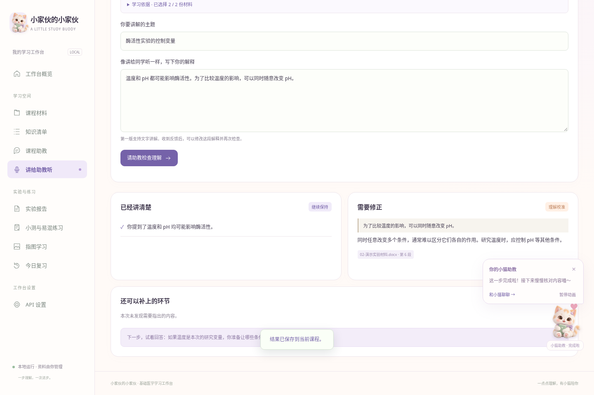

这不是正式考试评分，不要把一次反馈当成掌握证明。更好的办法是：修改后合上材料，再解释一遍，过几天再回忆。

## 10. 实验报告：固定内容先准备，数据与结论自己填

1. 在“课程材料”先上传正式实验指导书，用途选“实验材料”；有学校模板时，另外上传并选“报告模板”。
2. 点击“实验报告”，在“学习依据”勾选与本次实验有关的材料。
3. 填写实验名称，选择学校模板；没有模板可使用标准结构。
4. 点击“生成报告与实验学习卡”。
5. 先检查页面预览和来源。如果材料没有提供某项试剂或步骤，先补充指导书，不要把模型猜测当作实验要求。
6. 点击“下载 Word”，文件通常进入浏览器的“下载”文件夹。可按 Ctrl+J 查看浏览器下载记录。
7. 用 Word 或 WPS 打开下载的实验报告，核对学校格式，填写姓名、学号、真实数据、结果、讨论和结论。

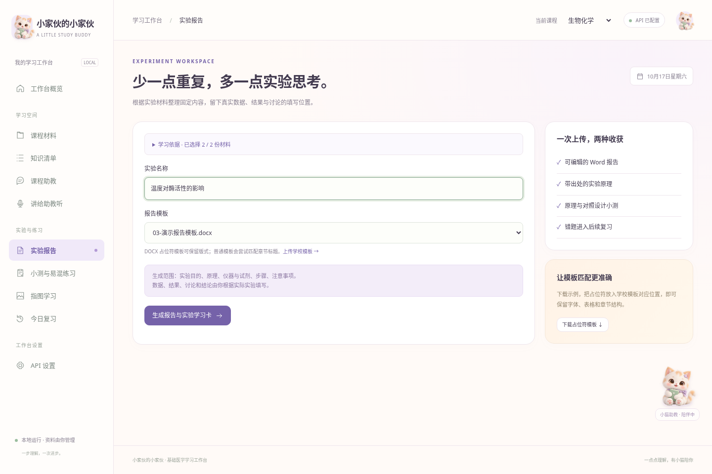

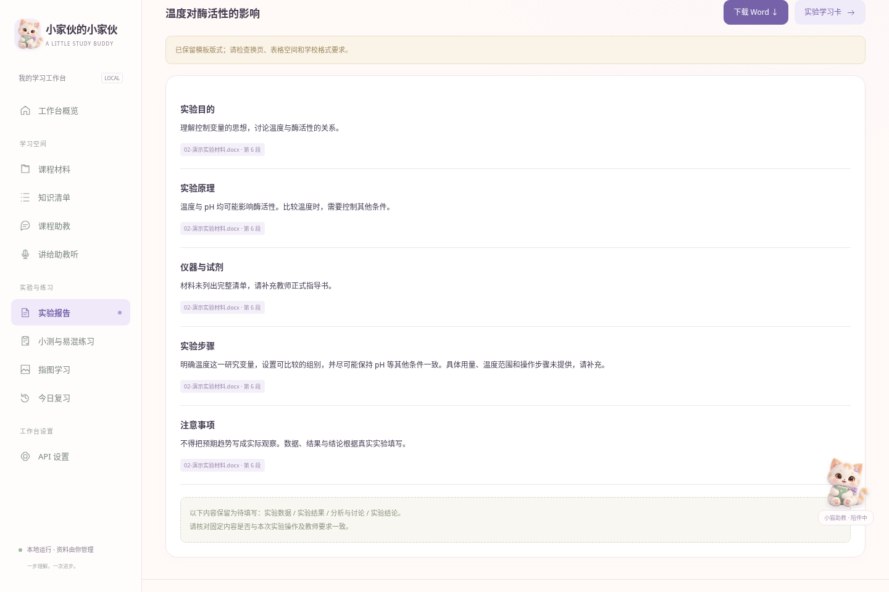

| 工具可以整理 | 必须根据真实实验填写 |
| --- | --- |
| 实验目的、实验原理 | 实验数据与单位、实际观察现象 |
| 材料中明确列出的仪器与试剂 | 实验结果 |
| 材料中明确列出的步骤与注意事项 | 分析与讨论、实验结论 |

> 分析、讨论和结论虽然不是数据表格，但依赖实际结果，因此不会预先替你填写。正式提交前，按老师允许的 AI 使用范围检查并修改报告。

## 11. 学校模板对不上，怎么办？

模板决定格式，实验材料决定内容。最可靠的方式是在学校 DOCX 模板对应位置放入占位符。占位符就是一对双大括号包住的字段名。

1. 在实验报告页点击“下载占位符模板”，先看看示例；也可使用 docs/examples/03-演示报告模板.docx。
2. 用 Word/WPS 打开学校模板，在需要放实验目的正文的位置输入 {{实验目的}}，在原理位置输入 {{实验原理}}，依次放好其他占位符。
3. 保留学校要求的标题、表格和字号，把模板另存为一个新的 DOCX。
4. 回到“课程材料”按“报告模板”上传这个新文件；在实验报告页重新选择并生成。

支持的中文占位符：{{实验名称}}、{{实验目的}}、{{实验原理}}、{{仪器与试剂}}、{{实验步骤}}、{{注意事项}}、{{实验数据}}、{{实验结果}}、{{分析与讨论}}、{{实验结论}}。不要省略大括号，也不要换成全角括号。

普通 DOCX 没有占位符时，会尝试匹配明确的章节标题；无法识别或使用非 DOCX 模板时，可能退回标准 Word 结构。工具不能保证所有复杂版式一模一样；请检查换页、表格空间和模板里原有的示例数据。上传的原模板不会被覆盖。

## 12. 小测与易混练习：先做，再看答案

1. 点击“小测与易混练习”。在“章节小测”选择材料、填写主题、选择题量，然后生成。
2. 为每一道题选一个答案，答完后再提交。提交前不显示标准答案与解析。
3. 提交后查看正确题数、解析和来源。错题会加入今日复习，不需要另外复制。
4. 想区分两个概念时，切换到“易混知识对照”，填写概念 A、概念 B，并先写下自己的初步判断。
5. 生成后对照比较表，再完成下面的新情境题。初步判断主要供你自我对照；需要逐句纠错时，使用“讲给助教听”。

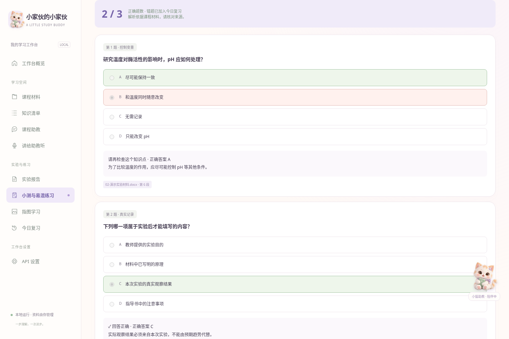

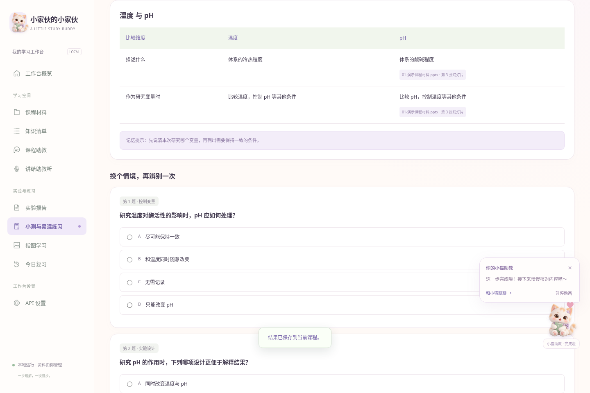

自动生成题目可能存在歧义或材料支持不足。发现疑问时先点来源，并请教师或助教核对，不要仅凭工具答案改掉正确的教材知识。

## 13. 指图学习：自己建立可靠的小题库

1. 准备一张没有现成答案标签的图片，推荐教师提供的图谱或课程示意图。PNG、JPG 或 WebP，最大 10 MB。
2. 点击“指图学习”，上传图片。
3. 在图片上点击你要练习的结构，出现数字标记。
4. 在右侧填写结构名和辨认依据/出处。接受多个名称时用 / 分隔，例如“细胞核 / nucleus”。
5. 对照教师图谱确认名称和位置正确，再勾选确认并点击“保存标注”。修改名称后，需要重新确认。
6. 切换到“隐藏标签练习”，按编号输入结构名，提交后核对。没有匹配到的正确别名，可以自己核对后回到标注中补充。

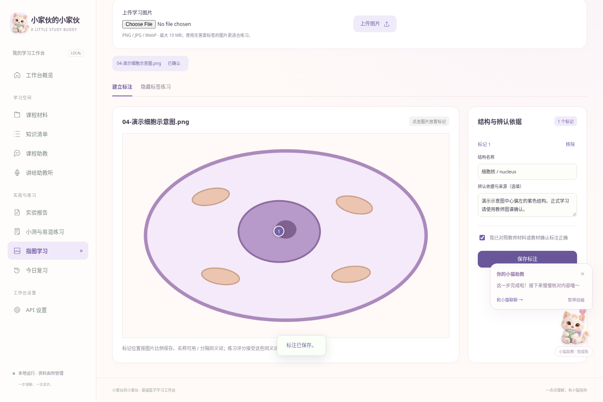

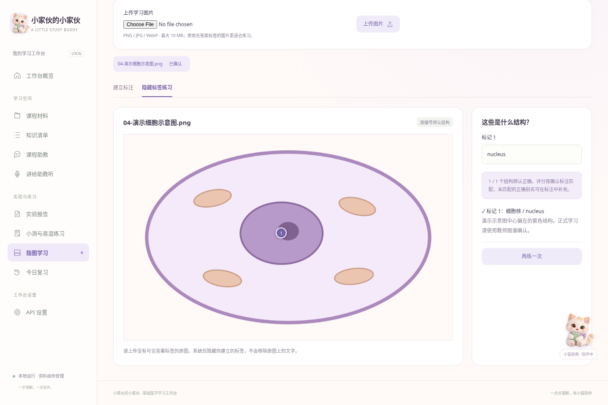

> 这里不自动诊断病理切片，也不自动判断未知图片的结构。题目质量取决于已确认标注。系统不会擦掉原图中印着的答案；如果原图有答案，应先换一张适合练习的图。

## 14. 今日复习、小猫互动和历史记录

1. 点击“今日复习”，先尝试写下你记得的内容，再点击“查看参考内容”。
2. 对照后选择“已能回忆，安排下次”或“还需巩固，明天再练”。这是自评，不是机器给你的医学能力评分。
3. 能回忆后的间隔依次为 1、3、7、14、30、60 天；未记住时明天再练。当前课程没有到期卡片时会提示今日完成。
4. 各学习页上方的“已保存的学习记录”可以展开，查看原有清单、报告、小测或反馈。切换课程后，记录也随课程切换。

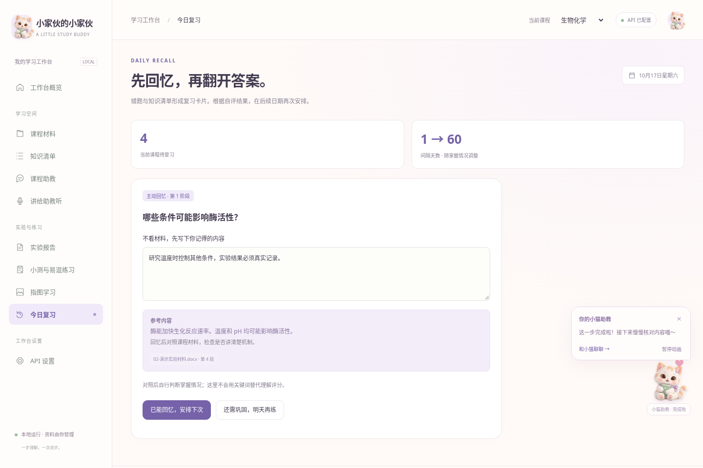

点击首页或右下角小猫，可以摸摸它或打开提示。提示框内可暂停/开启动画，也可点击 × 收起。摸猫和这些动画不消耗模型额度。等待时的思考、完成后的庆祝，都只是请求状态。

给自己一个可执行的节奏：课后整理一小章 → 解释一个机制 → 做 5 道题 → 第二天花 10 分钟回忆。每次范围小一点，比一次生成大量内容更容易真正用起来。

## 15. 常见问题：照着现象找解决办法

| 现象/提示 | 先这样做 |
| --- | --- |
| 双击后提示找不到 Python | 回到第 2 节安装 Python 3.12 64 位，勾选 Add python.exe to PATH。重新打开项目文件夹后再双击。 |
| 首次下载组件很慢或失败 | 看启动窗口是否仍在下载。若明确出现网络失败，检查网络后再启动；不需要删除课程资料，也不要手动修改 requirements.txt。 |
| 窗口一闪而过 | 确认你先解压了项目、双击的是 start.bat。若仍出现，记录 Windows 版本和 Python 版本，把启动错误交给维护者。 |
| 浏览器打不开 | 保持启动窗口打开，按 Ctrl+L 输入 http://127.0.0.1:8765。检查是否把 http 写成 https。 |
| Port 8765 is already in use | 可能已经开着另一个启动窗口。先试着在浏览器打开地址；若仍有冲突，关闭多余窗口。需要换端口时请维护者协助，不必自己改源码。 |
| 请先填写密钥 / API 未配置 | 进入 API 设置重新输入本次密钥；若刚重启服务，这是正常现象。 |
| API 密钥无效或已过期 | 确认复制完整、没有多余空格，密钥属于当前基础地址的服务商，且未失效。不要把完整密钥发给维护者。 |
| API 拒绝访问 | 检查账户是否有该服务和模型权限，以及当前网络能否访问服务商。 |
| API 地址或模型不存在 | 检查基础地址和模型标识。不要在基础地址末尾加 /chat/completions。 |
| 额度不足或请求过于频繁 | 到自己的服务商账户确认额度，或稍后重试。不要连续点击生成。 |
| 请求超时 | 检查网络和服务状态，减少勾选材料、缩小学习主题后再试。 |
| 模型输出格式不符合要求 / 引用了未提供位置 | 本次结果未保存。缩小材料范围再试，或换成服务商明确支持中文 JSON 输出的兼容模型。 |
| 材料未提取到文字 | 文件可能是扫描图片或已加密。先用可靠工具做 OCR、解除自己有权解除的密码，或上传可复制文字的版本。 |
| 报告格式和学校要求不同 | 参考第 11 节制作 DOCX 占位符模板；生成后仍需人工检查页码和表格。 |
| 为什么别的课程看不到刚上传材料 | 检查右上角课程是否选对。不同课程分别保存材料，不自动混在一起。 |
| 答对了但指图仍判不匹配 | 评分按照标准名称/别名匹配。先核对教材，再把正确别名用 / 补充到已确认标注。 |
| 原文来源打不开了 | 材料可能已删除。旧生成记录仍在，但删除的原文件无法再查看；必要时重新上传正式材料。 |

向维护者求助时，提供：你点击了哪个页面、做了哪一步、看到什么完整提示、文件类型和大小。截图前遮住 API 密钥及个人信息。优先发送错误文字，不要发送自己的整个 data 文件夹。

## 16. 关闭、备份、换电脑和更新

1. 结束使用时先保存正在编辑的 Word 文件。回到启动窗口，按 Ctrl+C；若 Windows 询问是否终止批处理，可按提示确认。
2. 关闭服务后，在项目文件夹找到 data 文件夹。把整个 data 复制到自己的备份位置，例如移动硬盘。不要在服务正在写入时直接替换数据库文件。
3. 换电脑时：重新下载/解压项目并安装 Python，先不要启动；把自己的备份 data 文件夹放进新项目、与 start.bat 同一层，再启动。
4. 更新代码时：先关闭服务并备份 data，把新版解压到新文件夹，将旧 data 复制过去。新版本可能重新安装所需组件；不要直接删除旧资料。
5. 更新或换电脑后，重新填写 API 密钥并测试。建议确认材料和报告都在，再处理旧项目文件夹。

data 保存材料、图片、记录和导出报告；.venv 是运行组件，通常不需要迁移；dist 是维护者生成的部署包。初学者只需记住：备份 data，启动 start.bat。关闭浏览器标签页不会自动关闭服务，关掉启动窗口才会结束本次运行。

## 17. 录屏章节与自己练一遍的清单

视频位于 docs/media/小家伙的小家伙-操作演示.mp4。有中文画面提示，没有配音；可暂停查看。视频模型使用本机固定示例，不能照抄其中地址、模型名或演示密钥。单独的演示字幕.srt 可供支持字幕的播放器加载。

| 开始时间 | 章节 | 你会看到什么 |
| --- | --- | --- |
| 00:00 | 01 / 欢迎来到你的学习工作台 | 这是网页操作实录。Windows 安装步骤请看说明书；本片使用模拟 API，不展示真实模型效果。 |
| 00:08 | 02 / 小猫会陪你学习 | 点击小猫可以摸摸它；提示可收起，动画也可以暂停。摸猫不会调用 API。 |
| 00:21 | 03 / 第一次使用：填写 API 三项信息 | 基础地址、模型名称、API 密钥来自你的服务商。不要照抄片中的本机演示地址和模型名。 |
| 00:35 | 04 / 先选课程，再上传材料 | 这里选择生物化学。课程材料、实验材料、报告模板用途不同，请按用途分别上传。 |
| 00:54 | 05 / 知识清单：先看结构，再主动回忆 | 选择材料和学习范围，生成后可点击来源核对原文，再把问题加入复习。 |
| 01:15 | 06 / 课程助教：从一个为什么开始 | 输入你没弄懂的问题。小猫思考后给出解释与来源；看完答案，还可以接着追问。 |
| 01:27 | 07 / 讲给助教听：找出理解中的漏洞 | 先用自己的话解释。反馈会区分已经讲清楚和需要修正的部分，你可以修改后再提交。 |
| 01:40 | 08 / 实验报告：生成固定内容，保留真实记录 | 选择报告模板并生成。数据、观察、结果、讨论和结论仍需你根据实际实验填写。 |
| 01:57 | 09 / 实验学习卡：作答后才显示解析 | 报告关联原理小测。请答完每一道题，再点击提交；答错的题会进入今日复习。 |
| 02:11 | 10 / 易混知识：先辨别，再对照 | 写下你对两个概念的初步判断，再看比较表，最后完成新的情境题。 |
| 02:27 | 11 / 指图学习：先建立可靠标注 | 上传无答案标签的图片，点击结构填写名称。演示使用简化示意图，不是显微照片。 |
| 02:39 | 12 / 隐藏标签：辨认结构并核对 | 系统只隐藏你添加的标签，不会擦除原图的文字。评分按已确认名称及别名匹配。 |
| 02:50 | 13 / 今日复习：先回忆，再看参考 | 先写下你记得的内容，再查看参考。能回忆就安排下一次，仍不熟悉就明天再练。 |
| 03:04 | 14 / 下次怎么打开？资料怎么保留？ | 每天双击 start.bat，保持启动窗口打开；服务重启后重填密钥。备份前关闭服务，再复制整个 data 文件夹。 |
| 03:13 | 15 / 现在可以自己试一遍了 | 先用 docs/examples 里的练习材料操作。真实 API、正式课件和医学内容，请以你实际的服务与课程要求为准。 |

1. 找到项目文件夹和 start.bat，能够自己启动和关闭。
2. 用自己的服务商信息通过一次测试连接。
3. 选择一门课程，上传一份讲义并查看原文。
4. 生成一份小主题知识清单，加入主动回忆。
5. 向助教问一个问题，并点来源核对。
6. 用自己的话解释一个知识点，修改反馈指出的问题。
7. 生成报告固定内容并找到下载的 Word，确认数据和结论仍待填写。
8. 完成一次小测，查看一条错题解析。
9. 用一张已确认图谱建立标注并做一次指图练习。
10. 完成一张今日复习卡；关闭服务后备份 data。

> 如果以上十项能独立完成，你已经掌握了日常使用流程。遇到某一步失败，可以直接回到对应章节，不必重新安装所有东西。
